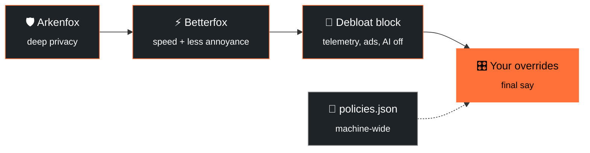
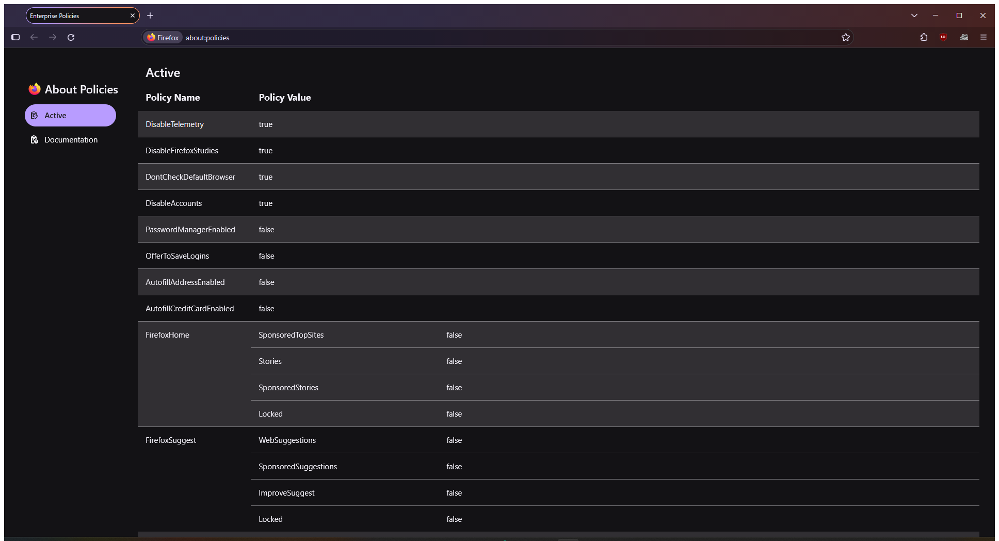
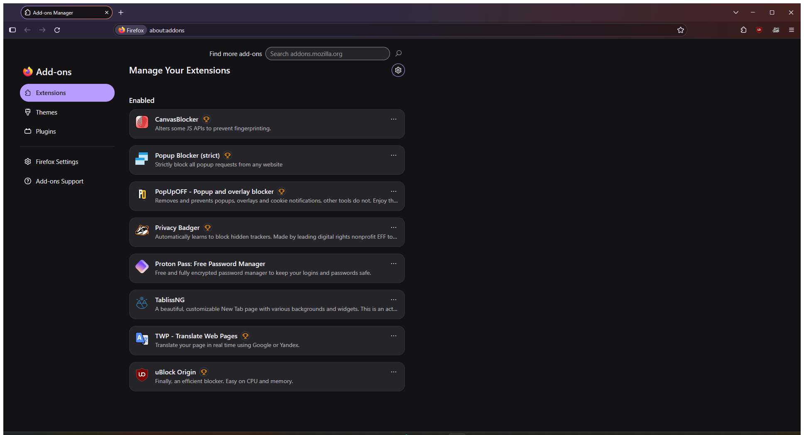
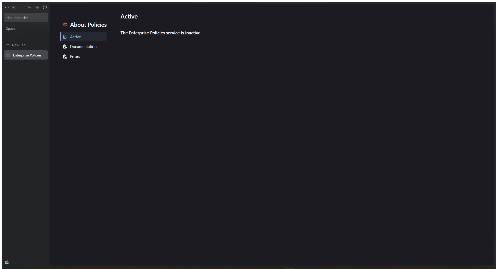

<div align="center">


<a href="https://github.com/apauruseya-stack/firefox-hardened">
  
</a>

<br/>


**A layered, reversible hardening stack for the real Mozilla Firefox, now verified on Zen Browser too.**
<br/>
`firefox-debloat` + `Arkenfox` + `Betterfox` + your own overrides, stacked in the right order.

[**Quick start**](#-quick-start) · [**Zen Browser**](#-zen-browser-tested) · [**The layers**](#-the-four-layers) · [**Why this stack**](#-why-this-stack) · [**Revert**](#-undo-everything) · [**Screenshots**](#-screenshots)

</div>

<br/>

> [!NOTE]
> **Status:** personal toolkit, shared as-is. Read the [warnings](#-warnings--trade-offs) before applying.

---

## ✨ The 10-second pitch

| | |
|---|---|
| 🦊 **Real Firefox** | Official Mozilla binary. This stack forks nothing and ships no third-party build. Full site and DRM support (Netflix, banking) and instant security updates. |
| 🧘 **Zen Browser too** | The full stack (policies, `user.js`, extensions) works on Zen, verified on Zen 1.23.3b / Windows 11. [See the Zen guide](#-zen-browser-tested). |
| 🧹 **Debloated** | Telemetry, studies, crash reports, sponsored content, Firefox Suggest, recommendations and AI features are switched off. |
| 🛡️ **Hardened** | ETP Strict, HTTPS-only, referer trimming, containers, FPP, optional RFP, plus CanvasBlocker. |
| ⚡ **Fast** | Betterfox network, cache and GFX tuning with speculative loading re-enabled. |
| ♻️ **Reversible** | One command to roll back. Backups are created automatically. |

---

## 🧱 The four layers

Firefox reads `user.js` on every start and the **last value wins**. Enterprise policies (`policies.json`) apply machine-wide and show up in `about:policies`.



> **Order matters:** Arkenfox → Betterfox → debloat block → overrides. The more specific and personal a layer is, the later it loads, so it wins.

| Layer | Source | Scope | Reversible? |
|---|---|---|---|
| 📜 **Policies** | `config/policies.json` (firefox-debloat) | all profiles, all users | ✅ `.debloat-orig` backup |
| 🧹 **Debloat prefs** | managed block in `user.js` | per profile | ✅ block removed on `-Revert` |
| 🛡️ **Arkenfox** | full `user.js` template | per profile | ✅ restore backup |
| ⚡ **Betterfox** | curated `user.js` | per profile | ✅ restore backup |
| 🎛️ **Overrides** | appended prefs | per profile | ✅ delete the block |

The debloat script is **idempotent** and leaves everything outside its managed block alone, so re-running it never wipes your Arkenfox, Betterfox or override layers.

---

> [!WARNING]
> **Two things to know before you apply:**
> 1. **Stay logged in.** Arkenfox clears cookies and site data on close by default. This stack's overrides disable that so you stay signed in. Remove those override lines for the stricter default.
> 2. **Some sites may break.** ETP Strict, RFP, CanvasBlocker and disabled prefetch can affect banking, captchas and some web apps. Use the shield icon in the address bar to add per-site exceptions, or turn RFP off in overrides.

## 🚀 Quick start

### 📋 Requirements

| | Windows | Linux |
|---|---|---|
| **Interpreter** | Windows PowerShell 5.1+ (built in) or PowerShell 7+ | Bash 4+ |
| **Dependencies** | none | `jq` |
| **Privileges** | UAC prompt only for the policies step | `sudo` only for `policies.json` |
| **Firefox** | installed and opened once (so a profile exists) | same |

> 💡 Recommended: **Firefox 152+** (needed for the `AIControls` and `DisableAccounts` policies).
>
> 🧪 **Tested on:** Firefox 158 / Windows 11 (PowerShell 5.1 and 7). Zen Browser 1.23.3b also verified. Linux documented but merge step is newer; macOS is untested (policies path differs).
>
> 🧘 Using **Zen Browser** instead? Same requirements, plus the manual paths in the [Zen guide](#-zen-browser-tested).

### 🪟 Windows

**One-line install** (downloads, verifies the SHA-256, runs, cleans up):

```powershell
irm https://raw.githubusercontent.com/apauruseya-stack/firefox-hardened/main/install/install.ps1 | iex
```

**Or from the source** (full control, easier to read first):

```powershell
# 1. Clone
git clone https://github.com/apauruseya-stack/firefox-hardened.git
cd firefox-hardened

# 2. Install Firefox if you don't have it
winget install --id Mozilla.Firefox --silent --accept-package-agreements --accept-source-agreements

# 3. Open Firefox once, then close it (this creates your profile)
& "C:\Program Files\Mozilla Firefox\firefox.exe"

# 4. See what would change, without writing anything
powershell -ExecutionPolicy Bypass -File .\windows\firefox-debloat.ps1 -Preview

# 5. Apply the debloat layer (UAC prompt appears for the policies step)
powershell -ExecutionPolicy Bypass -File .\windows\firefox-debloat.ps1
#    Want to keep Sync?        add:  -KeepSync
#    Want a lighter profile?   add:  -Preset quick
#    See the presets:          -ListPresets

# 6. Layer Arkenfox + Betterfox on top
powershell -ExecutionPolicy Bypass -File .\scripts\merge-arkenfox-betterfox.ps1

# 7. (Optional) personal overrides, see "Customizing" below

# 8. Restart Firefox, then verify at about:policies and about:config
```

<details>
<summary><b>📦 Downloaded as a ZIP?</b> Unblock the files first</summary>

```powershell
Get-ChildItem -Recurse | Unblock-File
```

</details>

### 🐧 Linux

```bash
git clone https://github.com/apauruseya-stack/firefox-hardened.git
cd firefox-hardened

# See what would change, without writing anything
./linux/firefox-debloat.sh --preview

# Apply the debloat layer (asks for sudo when it writes policies.json)
./linux/firefox-debloat.sh
#   --preset quick     a lighter profile
#   --list-presets     what the presets do
#   --keep-sync        keep Firefox Account and Sync

# Layer Arkenfox + Betterfox on top
./scripts/merge-arkenfox-betterfox.sh
```

Both scripts are idempotent and reversible (`--revert`).

### 🍎 macOS (untested)

macOS is not tested, but it should mostly work. Notes:

- Enterprise policies live in `/Library/Application Support/Mozilla/policies/policies.json` (or the app bundle's `distribution/` folder), not `/etc/firefox/policies`. Use `-PolicyDir` / `FIREFOX_POLICY_DIR` to point at the right folder.
- Profile location: `~/Library/Application Support/Firefox/Profiles/`.
- The Bash merge script works the same way; profile discovery covers the standard path above.

If you try it on a Mac, please open an issue with what worked and what didn't.

---

## 🧘 Zen Browser (tested)

[Zen Browser](https://zen-browser.app) is a Gecko-based Firefox fork with vertical tabs and workspaces. **The full stack works on Zen**, verified on **Zen 1.23.3b / Windows 11**.

| Layer | Status | Details |
|---|:---:|---|
| 📜 **Policies** | ✅ | Zen reads `policies.json` from `C:\Program Files\Zen Browser\distribution\` (created with admin rights). `about:policies` shows them as active. |
| 🧱 **user.js** | ✅ | Zen reads `user.js` from `%APPDATA%\zen\Profiles\<profile>\`. The Arkenfox + Betterfox + overrides layers apply normally. |
| 🧩 **Extensions** | ✅ | Firefox-compatible extensions install, and policy-based auto-install (`ExtensionSettings`) is supported. |
| 🔎 **Script auto-detection** | ⚠️ | The firefox-debloat script looks for Mozilla Firefox paths, so it **won't find Zen automatically**. Point it at Zen manually (below). |

### 🪟 Apply the stack to Zen (Windows)

```powershell
# 1. Open Zen once, then close it (this creates your profile)

# 2. Debloat layer: tell the script where Zen's policy folder is (admin rights needed)
powershell -ExecutionPolicy Bypass -File .\windows\firefox-debloat.ps1 -PolicyDir "C:\Program Files\Zen Browser\distribution"

# 3. Arkenfox + Betterfox layer: pass your Zen profile folder to the merge script
powershell -ExecutionPolicy Bypass -File .\scripts\merge-arkenfox-betterfox.ps1 -ProfileDir "$env:APPDATA\zen\Profiles\<profile>"

# 4. Restart Zen and check about:policies and about:config
```

> [!TIP]
> Not sure which folder is your Zen profile? Open `about:support` in Zen and look at **Profile Folder**.

> [!NOTE]
> Zen is a fork, so its updates come from Zen's own release channel rather than directly from Mozilla. The stack itself changes nothing about that: it only adds policies and prefs on top.

To undo it on Zen, close Zen and run the same debloat command with `-Revert` and the same `-PolicyDir`, then restore your profile's `user.js` backup as described in [Undo everything](#-undo-everything).

---

## 🎯 What it does (and doesn't)

<table>
<tr>
<td width="50%" valign="top">

### ✅ Does

- 🚫 Disables telemetry, Shield/Normandy studies, crash reports, sponsored content, Firefox Suggest, recommendations, AI features and Mozilla promotions
- 🔍 Sets **Brave Search** as the default engine (via the `SearchEngines` policy)
- 🧩 Auto-installs a curated extension set (see below)
- 🔑 Turns off built-in password manager, address and card autofill and Web Payments (Proton Pass replaces them)
- 🧼 Cleans the new tab page and UI annoyances (blank new tab, no Top Sites or sponsored content)
- 🛡️ Hardens privacy: ETP Strict, HTTPS-only, disk cache off, referer trimming, containers, FPP, optional RFP, sanitizing
- ⚡ Tunes network, caches, GFX and speculative loading
- 🔄 Optionally disables Firefox Account / Sync (`-KeepSync` / `--keep-sync` keeps it)

</td>
<td width="50%" valign="top">

### ❌ Does not

- 🔁 Change your search engine after the fact if you override it in Firefox settings (the policy sets the *default*)
- ➕ Install extensions outside `ExtensionSettings` (add others manually)
- 🔓 Disable security features: **Safe Browsing, updates and Remote Settings stay on**
- 🎭 Go beyond FPP / RFP / CanvasBlocker for fingerprinting (no custom spoofs beyond what Arkenfox provides)
- 🍪 Touch cookies, history or passwords beyond the sanitize-on-shutdown defaults (which you can disable in overrides)
- 🏠 Change your homepage (startup page is blank via Arkenfox, new tab is Firefox default unless you add an extension)

</td>
</tr>
</table>

### 🧩 Auto-installed extensions

| Extension | Purpose |
|---|---|
| **uBlock Origin** | content blocking |
| **Proton Pass** | password manager (replaces Firefox's built-in one) |
| **Privacy Badger** | tracker learning and blocking |
| **CanvasBlocker** | per-site canvas / WebGL / audio randomization |
| **TWP (Translate Web Pages)** | translation |
| **PopUpOFF** | popup and overlay control |
| **Popup Blocker (strict)** | popup blocking |

---

## 🥊 Why this stack

How it compares with **stock Firefox** and **LibreWolf**:

| | Stock Firefox | LibreWolf | **This stack** |
|---|:---:|:---:|:---:|
| Telemetry / ads / AI removed | ❌ | ✅ | ✅ |
| Security features kept | ✅ | ⚠️ Mostly | ✅ |
| Official Mozilla binary and updates | ✅ | ❌ | ✅ |
| Site / DRM compatibility | 🏆 Best | ⚠️ Reduced | 🏆 Best |
| Fingerprinting protection | ❌ None | RFP (standardize) | FPP + optional RFP + CanvasBlocker (randomize) |
| Reversible | n/a | Uninstall | ✅ `-Revert` (Windows) / `--revert` (Linux) |
| Breakage risk | None | Higher | Low |
| Setup effort | None | Install a browser | Run scripts |

<details>
<summary><b>🕵️ Fingerprinting</b></summary>

- **Stock Firefox:** no fingerprinting protection. Your real UA, screen size, timezone, canvas, WebGL, fonts, hardware concurrency and DNT header are exposed. Cover Your Tracks reports a unique fingerprint.
- **LibreWolf:** RFP is on by default. It's strong, but it forces GMT timezone, light theme and window letterboxing, and breaks some sites. The RFP population is small, so you can still look unique.
- **This stack:** RFP is available (enable it in overrides) plus CanvasBlocker in "fake" mode, which randomizes canvas / WebGL / audio / DOMRect / screen / navigator **per site** (Brave-like). The DNT header is disabled to remove an identifying bit, and FPP (via ETP Strict) is on by default. Per-site randomization makes cross-site tracking much harder while keeping more sites working.

</details>

<details>
<summary><b>🔒 Safety and security</b></summary>

- **Stock Firefox:** Safe Browsing, updates and Remote Settings are on, but telemetry, studies and crash reports send data out.
- **LibreWolf:** disables many features, and some security-related remote services may be reduced. Updates come from LibreWolf's own channel, which can lag.
- **This stack:** keeps every security feature on (Safe Browsing, updates, Remote Settings, captive portal) and removes data collection and ad / tracking content. It uses the official Mozilla binary, so Mozilla's security updates arrive immediately. Policies are official enterprise mechanisms: reversible, auditable, visible in `about:policies`.

</details>

<details>
<summary><b>⚡ Speed and performance</b></summary>

- **Stock Firefox:** default network and cache settings, speculative loading on.
- **LibreWolf:** RFP and stricter settings can slow some loads, and letterboxing adds overhead.
- **This stack:** Betterfox Fastfox tuning (more connections, larger buffers, DNS cache, media / image cache, skia font cache) plus re-enabled speculative loading (DNS prefetch, link prefetch, speculative connections). Disk cache is off for privacy; enable it in overrides for faster repeat loads.

</details>

<details>
<summary><b>🧰 Convenience and compatibility</b></summary>

- **Stock Firefox:** nothing to set up, but noisy (telemetry, ads, AI, recommendations).
- **LibreWolf:** a separate browser with its own profile and update channel. It breaks some sites (banking, video, captchas) and is harder to undo.
- **This stack:** runs on stock Firefox with full site and DRM compatibility, official updates, and a one-command revert. It keeps your profile and extensions, auto-installs the curated extension set, and can keep Sync with `-KeepSync`.

</details>

---

## 🎛️ Customizing

| I want to... | Do this |
|---|---|
| Change policies or debloat prefs | Edit `config/policies.json` / `config/user.js`, then re-run the script |
| Use a lighter profile | `-Preset quick` / `--preset quick` (see the presets below) |
| See what a preset does | `-ListPresets` / `--list-presets` |
| Check what would change, without writing | `-Preview` / `--preview` |
| Keep Firefox Sync | `-KeepSync` / `--keep-sync` |
| Lock policies (greyed out in the UI) | `-Lock` / `--lock` |
| Block local translation too | `-BlockTranslations` / `--block-translations` |
| Tweak Arkenfox | Edit prefs in its `user.js` (look for `[SETUP-*]` tags). RFP is off by default; enable it in overrides |
| Add personal overrides | Copy `overrides/user-overrides.example.js`, edit it, and **append it to the end of your profile's `user.js`** (it is not auto-loaded) |
| Change a risk label | Edit `config/risk.json` (labels only, no behavior change) |

---

## 🧰 Presets, preview and the ledger

### Presets

A preset is a named subset of `config/`. List them with `-ListPresets` (Windows) or `--list-presets` (Linux).

| Preset | What it does | Risk |
|---|---|:---:|
| **quick** | The loudest extras only: telemetry, studies, crash reports, sponsored content and AI features. Keeps your account, Sync, password manager and search engine. | low |
| **recommended** | Everything in `config/`: telemetry, ads, AI, suggestions and Mozilla messages off, Brave Search default, extensions auto-installed, built-in password manager and Firefox Account/Sync disabled. | low |
| **strict** | `recommended` plus every policy locked (greyed out in the UI) and local page translation blocked as well. | medium |
| **keep-sync** | `recommended`, but Firefox Account and Sync stay enabled so bookmarks, passwords and tabs keep syncing. | low |

```powershell
powershell -ExecutionPolicy Bypass -File .\windows\firefox-debloat.ps1 -Preset quick
```

### Preview and risk labels

`-Preview` shows what would change and writes nothing. It never asks for elevation.

```
==> Preview: policies at C:\Program Files\Mozilla Firefox\distribution\policies.json
[safe]  change  DisableTelemetry                        Turn off telemetry
[medium] add     DisableAccounts                         Turn off Firefox Account and Sync
[safe]  same    FirefoxHome                             Remove sponsored content and stories from the new tab
```

Every policy has a risk label in `config/risk.json`:

| Label | Meaning |
|:---:|---|
| **safe** | Nothing you use is affected. |
| **low** | A small convenience is lost. |
| **medium** | You will notice the change: no Sync, no password prompts, AI features gone. |
| **high** | Features break or data is deleted. |

### The ledger

Every run records **what the tool wrote** in a small JSON ledger (next to the policies, and one for the profiles). `-Revert` uses it to undo exactly its own values:

- a value you changed yourself after the run is **left alone** and reported,
- a policy that was never ours (from your organization or another tool) is **kept**,
- everything else the tool wrote is removed, and the original file is restored byte for byte.

---

## ⚠️ Warnings & trade-offs

> [!WARNING]
> This stack trades a little privacy for convenience in a few places. Know them before you apply it.

1. **Stay-logged-in vs. privacy.** Arkenfox clears cookies and site data on close. The provided overrides disable that so you stay signed in. Remove those override lines for the stricter default.
2. **RFP is optional.** Enabling it forces GMT timezone, prefers the light theme and rounds window size. It can break canvas-heavy or timezone-sensitive sites.
3. **Speculative loading is re-enabled** for speed, which is a minor privacy trade-off.
4. **Disk cache stays off** for privacy. Enable it in overrides for faster repeat loads.
5. **Site breakage.** ETP Strict + RFP + disabled prefetch can break a few sites (banking, captchas, some web apps). Use the shield icon in the address bar to add per-site exceptions.
6. **Extensions are force-installed** via policy. To change the list, edit `ExtensionSettings` in `config/policies.json` and re-run. To disable auto-install entirely, remove that block.
7. **CanvasBlocker + RFP** can run together. CanvasBlocker's FAQ confirms RFP can stay on, and its default mode is "fake" (per-site randomization).
8. **Brave Search preferences** ("Anonymous local results", "Discussions", "Anonymous usage metrics") are Brave settings, not Firefox settings. After your first search, open Brave Search's gear icon → Preferences and turn them off. The choice persists in a cookie for this profile.
9. **Profile data is never committed.** `.gitignore` excludes `prefs.js`, backups and `user-overrides.js`. Don't commit real profile files.

---

## ↩️ Undo everything

```powershell
# Close Firefox first (it rewrites prefs.js on exit).
powershell -ExecutionPolicy Bypass -File .\windows\firefox-debloat.ps1 -Revert
```

```bash
# Linux
./linux/firefox-debloat.sh --revert
```

The **ledger** decides what is undone: only the values this tool wrote are removed, and the original `policies.json` is restored byte for byte. A value someone else changed after the run is left alone and reported, and a policy that was never ours (from your organization, for example) is kept.

Then restore your profile's `user.js` from the backup the merge script created (`user.js.bak-<timestamp>` in the profile folder), or delete `user.js` entirely to return to Firefox defaults.

---

## ❓ FAQ

<details>
<summary><b>Will this break my logins?</b></summary>

By default, Arkenfox clears cookies and site data on close. This stack's overrides disable that, so you stay signed in. If you prefer the stricter default, remove those override lines. Either way, your saved passwords are untouched, and Proton Pass is auto-installed as an alternative.

</details>

<details>
<summary><b>Does it work with Firefox ESR or Developer Edition?</b></summary>

- **Firefox ESR:** yes, with caveats. Arkenfox recommends not using its updater on ESR and manually applying overrides. Some policies (like `AIControls`) need newer versions; on older versions they show up as errors in `about:policies`, but the `user.js` prefs still apply. See the firefox-debloat Firefox-version table.
- **Developer Edition / Nightly:** should work, but these change fast. Policies and prefs may be added or renamed. Test and adjust.
- **Firefox 152+ is recommended** for `AIControls` and `DisableAccounts`.

</details>

<details>
<summary><b>How is this different from running Arkenfox alone?</b></summary>

Arkenfox is a `user.js` template you copy over your profile. This stack:

- Adds **firefox-debloat** (official enterprise policies + a managed, idempotent block) for the things Arkenfox can't reach via prefs.
- Adds **Betterfox** performance and annoyance tuning.
- Auto-installs a curated extension set (uBlock Origin, Proton Pass, Privacy Badger, TWP, PopUpOFF, Popup Blocker, CanvasBlocker).
- Sets Brave Search as default and disables Firefox's password manager / autofill.
- Keeps everything in **managed blocks** so re-running is safe and reverting is one command.
- Pins and verifies the Arkenfox / Betterfox downloads.

Arkenfox is the privacy core; this stack wraps it with policy, performance, extensions and convenience.

</details>

<details>
<summary><b>Will it break my sites?</b></summary>

Possibly a few. ETP Strict, RFP, CanvasBlocker and disabled prefetch can affect banking, captchas and some web apps. Use the shield icon in the address bar to add per-site exceptions, or turn RFP off in overrides.

</details>

<details>
<summary><b>How do I add a per-site exception?</b></summary>

Click the shield icon in the address bar on the affected site, then disable "Enhanced Tracking Protection" for that site. For CanvasBlocker, use its toolbar icon.

</details>

<details>
<summary><b>How do I turn RFP off?</b></summary>

Remove or comment out the two `privacy.resistFingerprinting*` lines in your overrides (or in `user.js`), then restart Firefox.

</details>

---

## 🔧 Maintenance

- 🔄 Arkenfox and Betterfox are **pinned to a specific commit** in the merge scripts, and the download is checked against a **SHA-256 checksum**. The script aborts if the checksum does not match. A scheduled workflow opens an issue when upstream publishes a new version, so the pin is refreshed on purpose.
- 🧽 Arkenfox recommends running `prefsCleaner` after major Firefox updates to reset deprecated prefs.
- 🔁 The debloat script is idempotent. Re-running it regenerates policies from the original plus `config/`.
- 🔐 The one-line installer downloads a release asset and verifies its SHA-256 before running anything.

---

## 📸 Screenshots

<div align="center">

### Enterprise policies (`about:policies`)
<a href="screenshots/about-policies.png"></a>

<br/><br/>

### Installed extensions (`about:addons`)
<a href="screenshots/about-addons.png"></a>

<br/><br/>

### 🧘 Zen Browser: enterprise policies (`about:policies`)
<a href="screenshots/zen-about-policies.png"></a>

</div>

---

## 📋 Documented config items

<details>
<summary><b>Auto-checked against <code>config/</code> by CI</b></summary>

Every preference and policy applied by this stack, listed so the CI consistency check passes. See the upstream firefox-debloat README for the human-readable settings reference.

- `AIControls`
- `AIControls.Default`
- `AIControls.Translations`
- `AutofillAddressEnabled`
- `AutofillCreditCardEnabled`
- `DisableAccounts`
- `DisableDefaultBrowserAgent`
- `DisableFirefoxStudies`
- `DisableTelemetry`
- `DontCheckDefaultBrowser`
- `ExtensionSettings`
- `ExtensionSettings.78272b6fa58f4a1abaac99321d503a20@proton.me`
- `ExtensionSettings.CanvasBlocker@kkapsner.de`
- `ExtensionSettings.jid1-MnnxcxisBPnSXQ@jetpack`
- `ExtensionSettings.uBlock0@raymondhill.net`
- `ExtensionSettings.{036a55b4-5e72-4d05-a06c-cba2dfcc134a}`
- `ExtensionSettings.{154cddeb-4c8b-4627-a478-c7e5b427ffdf}`
- `ExtensionSettings.{de22fd49-c9ab-4359-b722-b3febdc3a0b0}`
- `FirefoxHome`
- `FirefoxHome.SponsoredStories`
- `FirefoxHome.SponsoredTopSites`
- `FirefoxHome.Stories`
- `FirefoxSuggest`
- `FirefoxSuggest.ImproveSuggest`
- `FirefoxSuggest.SponsoredSuggestions`
- `FirefoxSuggest.WebSuggestions`
- `OfferToSaveLogins`
- `PasswordManagerEnabled`
- `Preferences`
- `SearchEngines`
- `SearchEngines.Add`
- `SearchEngines.Default`
- `UserMessaging`
- `UserMessaging.ExtensionRecommendations`
- `UserMessaging.FeatureRecommendations`
- `UserMessaging.MoreFromMozilla`
- `UserMessaging.SkipOnboarding`
- `UserMessaging.UrlbarInterventions`
- `app.normandy.api_url`
- `app.normandy.enabled`
- `app.shield.optoutstudies.enabled`
- `breakpad.reportURL`
- `browser.aboutwelcome.enabled`
- `browser.ai.control.linkPreviewKeyPoints`
- `browser.ai.control.pdfjsAltText`
- `browser.ai.control.sidebarChatbot`
- `browser.ai.control.smartTabGroups`
- `browser.ai.control.smartWindow`
- `browser.ai.control.speechRecognition`
- `browser.crashReports.unsubmittedCheck.autoSubmit2`
- `browser.discovery.enabled`
- `browser.ml.chat.enabled`
- `browser.ml.linkPreview.enabled`
- `browser.newtabpage.activity-stream.asrouter.userprefs.cfr.addons`
- `browser.newtabpage.activity-stream.asrouter.userprefs.cfr.features`
- `browser.newtabpage.activity-stream.default.sites`
- `browser.newtabpage.activity-stream.feeds.section.topstories`
- `browser.newtabpage.activity-stream.feeds.telemetry`
- `browser.newtabpage.activity-stream.showSponsored`
- `browser.newtabpage.activity-stream.showSponsoredTopSites`
- `browser.newtabpage.activity-stream.telemetry`
- `browser.preferences.moreFromMozilla`
- `browser.shell.checkDefaultBrowser`
- `browser.tabs.crashReporting.sendReport`
- `browser.urlbar.suggest.quicksuggest.nonsponsored`
- `browser.urlbar.suggest.quicksuggest.sponsored`
- `browser.urlbar.trending.featureGate`
- `browser.vpn_promo.enabled`
- `datareporting.healthreport.uploadEnabled`
- `datareporting.policy.dataSubmissionEnabled`
- `datareporting.usage.uploadEnabled`
- `dom.payments.request.supported`
- `dom.private-attribution.submission.enabled`
- `extensions.formautofill.addresses.enabled`
- `extensions.formautofill.creditCards.enabled`
- `extensions.getAddons.showPane`
- `extensions.htmlaboutaddons.recommendations.enabled`
- `identity.fxaccounts.enabled`
- `privacy.donottrackheader.enabled`
- `signon.autofillForms`
- `signon.rememberSignons`
- `toolkit.coverage.endpoint.base`
- `toolkit.coverage.opt-out`
- `toolkit.telemetry.archive.enabled`
- `toolkit.telemetry.bhrPing.enabled`
- `toolkit.telemetry.coverage.opt-out`
- `toolkit.telemetry.enabled`
- `toolkit.telemetry.firstShutdownPing.enabled`
- `toolkit.telemetry.newProfilePing.enabled`
- `toolkit.telemetry.server`
- `toolkit.telemetry.shutdownPingSender.enabled`
- `toolkit.telemetry.unified`
- `toolkit.telemetry.updatePing.enabled`

</details>

---

## 🙏 Credits & licenses

| Project | Role | License |
|---|---|---|
| [firefox-debloat](https://github.com/henriquesebastiao/firefox-debloat) by henriquesebastiao | Vendored under `windows/`, `linux/`, `config/`, `tests/` | AGPL-3.0 (original license kept) |
| [Arkenfox user.js](https://github.com/arkenfox/user.js) | Deep privacy layer | MIT |
| [Zen Browser](https://zen-browser.app) | Additional supported browser (tested, not bundled) | see its repository |
| [Betterfox](https://github.com/yokoffing/Betterfox) | Performance and annoyance layer | see its LICENSE |
| This repo's original additions (merge script, overrides example, README) | Glue | AGPL-3.0, to stay compatible with the vendored code |

If you redistribute, keep the licenses and attribution.

<br/>

<div align="center">

**Found it useful? Drop a ⭐ and share it.**


</div>
