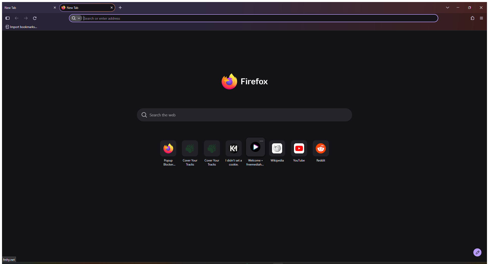

# firefox-hardened

A layered, **reversible** Firefox hardening stack for Windows (and Linux) that combines:

1. **firefox-debloat** - removes telemetry, ads, sponsored content, recommendations, AI features and (optionally) Firefox Account/Sync via official enterprise policies plus a managed `user.js` block.
2. **Arkenfox user.js** - deep privacy hardening (ETP Strict, HTTPS-only, disk avoidance, referer trimming, containers, FPP, optional RFP, sanitizing).
3. **Betterfox** - performance tuning (network, caches, GFX) plus annoyance removal (AI, new tab, URL bar, permissions).
4. **Personal overrides** - stay logged in, speculative loading for speed, anti-fingerprinting choice, Tabliss new tab, etc.

Everything runs on top of the **official Mozilla Firefox binary** - no fork, no third-party build, full site and DRM compatibility, official updates. All changes are reversible.

> Status: personal toolkit, shared as-is. Read the warnings before applying.

---

## Table of contents

- [What this does / does not do](#what-this-does--does-not-do)
- [Requirements](#requirements)
- [Quick start (Windows)](#quick-start-windows)
- [Quick start (Linux)](#quick-start-linux)
- [The layers explained](#the-layers-explained)
- [Customizing](#customizing)
- [Warnings and side effects](#warnings-and-side-effects)
- [Reverting](#reverting)
- [Maintenance](#maintenance)
- [Screenshots](#screenshots)
- [Credits and licenses](#credits-and-licenses)

---

## What this does / does not do

**Does:**

- Disables telemetry, studies (Shield/Normandy), crash reports, sponsored content, Firefox Suggest, recommendations, AI features, Mozilla promotions.
- Sets the default search engine to **Brave Search** (via the `SearchEngines` policy).
- Auto-installs **uBlock Origin**, **Proton Pass**, **Privacy Badger**, **TablissNG**, **TWP (Translate Web Pages)**, **PopUpOFF**, **Popup Blocker (strict)** and **CanvasBlocker** (via `ExtensionSettings`).
- Disables Firefox's built-in password manager, address and credit-card autofill, and Web Payments by default (Proton Pass replaces them).
- Cleans the new tab page and UI annoyances (Tabliss replaces the new tab page).
- Hardens privacy (ETP Strict, HTTPS-only, disk cache off, referer trimming, containers, FPP, optional RFP, sanitizing).
- Improves perceived performance (network connections, caches, GFX, speculative loading).
- Optionally disables Firefox Account / Sync (use `-KeepSync` / `--keep-sync` to keep it).

**Does NOT:**

- Change your search engine after the fact if you override it in Firefox settings (the policy sets the default).
- Install any extension not listed in `ExtensionSettings` (add others manually).
- Disable security features (Safe Browsing, updates, Remote Settings stay on).
- Harden against fingerprinting beyond FPP/RFP/CanvasBlocker (no custom fingerprint spoofs beyond what Arkenfox provides).
- Touch cookies, history or passwords beyond the sanitizing-on-shutdown defaults (which you can disable - see overrides).
- Change your homepage URL (the new tab page is replaced by Tabliss; the startup page is left blank by Arkenfox).

---

## Requirements

| Item | Windows | Linux |
|---|---|---|
| Interpreter | Windows PowerShell 5.1+ (ships with the system) or PowerShell 7+ | Bash 4+ |
| Dependencies | none | `jq` |
| Privileges | UAC only for the policies step | `sudo` only for `policies.json` |
| Firefox | Installed and opened at least once (so a profile exists) | same |

Recommended: Firefox 152 or newer (for the `AIControls` and `DisableAccounts` policies).

---

## Quick start (Windows)

```powershell
# 1. Clone
git clone https://github.com/apauruseya-stack/firefox-hardened.git
cd firefox-hardened

# 2. Install Firefox if needed (winget)
winget install --id Mozilla.Firefox --silent --accept-package-agreements --accept-source-agreements

# 3. Open Firefox once, then close it (creates a profile)
& "C:\Program Files\Mozilla Firefox\firefox.exe"
# (close it after it opens)

# 4. Apply the debloat layer (UAC prompt appears for the policies step)
powershell -ExecutionPolicy Bypass -File .\windows\firefox-debloat.ps1

# Keep Sync working:
#   powershell -ExecutionPolicy Bypass -File .\windows\firefox-debloat.ps1 -KeepSync

# 5. Layer Arkenfox + Betterfox on top
powershell -ExecutionPolicy Bypass -File .\scripts\merge-arkenfox-betterfox.ps1

# 6. (Optional) apply personal overrides
#    Copy overrides\user-overrides.example.js -> <profile>\user-overrides.js is not auto-loaded.
#    Instead, append its contents to the end of your profile's user.js.

# 7. Restart Firefox. Verify at about:policies and about:config.
```

If you downloaded as a ZIP, unblock the files first:

```powershell
Get-ChildItem -Recurse | Unblock-File
```

## Quick start (Linux)

```bash
git clone https://github.com/apauruseya-stack/firefox-hardened.git
cd firefox-hardened
./linux/firefox-debloat.sh
# then manually append Arkenfox + Betterfox user.js content + overrides to your profile's user.js
```

(Linux merge automation is not yet scripted - PRs welcome.)

---

## The layers explained

Firefox reads `user.js` on every start and applies its prefs (last value wins). Enterprise policies (`policies.json`) apply machine-wide and show up in `about:policies`.

| Layer | Source | Scope | Reversible |
|---|---|---|---|
| Policies | `config/policies.json` (firefox-debloat) | all profiles / all users | yes (`.debloat-orig` backup) |
| Debloat prefs | managed block in `user.js` | per profile | yes (block removed on `-Revert`) |
| Arkenfox | full `user.js` template | per profile | yes (restore backup) |
| Betterfox | curated `user.js` | per profile | yes (restore backup) |
| Overrides | appended prefs | per profile | yes (delete the block) |

Order matters: **Arkenfox -> Betterfox -> debloat block -> overrides**, so the more specific / personal values win.

The firefox-debloat script is idempotent and keeps anything outside its managed block intact, so re-running it preserves the Arkenfox / Betterfox / override layers.

---

## Customizing

- **Edit `config/policies.json` / `config/user.js`** (firefox-debloat inputs) and re-run the script.
- **Keep Sync:** run with `-KeepSync` / `--keep-sync`.
- **Lock policies (greyed out in UI):** `-Lock` / `--lock`.
- **Block local translation too:** `-BlockTranslations` / `--block-translations`.
- **Arkenfox options:** most are controlled by editing prefs in `user.js` (look for `[SETUP-*]` tags in the Arkenfox file). RFP is off by default; enable it in overrides if you want it.
- **Personal overrides:** copy `overrides/user-overrides.example.js`, edit, and append to the end of your profile's `user.js`.
- **Tabliss new tab:** `browser.newtabpage.enabled` must be `true` (set in the overrides example) so Tabliss can render.

---

## Warnings and side effects

1. **Stay-logged-in vs. privacy.** Arkenfox clears cookies and site data on close by default. The provided overrides disable that so you stay signed in. If you want the stricter default, remove those override lines.
2. **RFP (anti-fingerprinting) is optional.** Enabling it forces GMT timezone, prefers light theme, and rounds window size. It can break canvas-heavy or timezone-sensitive sites. Enable only if you accept that.
3. **Speculative loading re-enabled** (for speed) is a minor privacy trade-off.
4. **Disk cache stays off** (privacy). Enable it in overrides for faster repeat loads.
5. **Site breakage.** ETP Strict + RFP + disabled prefetch can break a few sites (banking, captchas, some web apps). Use the shield icon in the address bar to add per-site exceptions.
6. **Extensions are force-installed** (uBlock Origin, Proton Pass, Privacy Badger, TablissNG, TWP, PopUpOFF, Popup Blocker, CanvasBlocker) via policy. To change the list, edit `ExtensionSettings` in `config/policies.json` and re-run. To disable auto-install entirely, remove that block.
7. **CanvasBlocker + RFP.** CanvasBlocker's FAQ confirms RFP can stay on. CanvasBlocker's default mode is "fake" (per-site randomization). Having both RFP and CanvasBlocker is supported.
8. **Brave Search preferences** ("Anonymous local results", "Discussions", "Anonymous usage metrics") are Brave Search settings, not Firefox settings. After your first search, open Brave Search's gear icon -> Preferences and turn them off; the choice persists in a cookie for this profile.
9. **Profile data never committed.** `.gitignore` excludes `prefs.js`, backups, and `user-overrides.js`. Do not commit real profile files.

---

## Reverting

```powershell
# Close Firefox first (it rewrites prefs.js on exit).
powershell -ExecutionPolicy Bypass -File .\windows\firefox-debloat.ps1 -Revert
```

Then restore your profile's `user.js` from the backup created by the merge script (`user.js.bak-<timestamp>` in the profile folder), or delete `user.js` entirely to go back to Firefox defaults. Policies revert via the `.debloat-orig` backup automatically.

---

## Maintenance

- Arkenfox and Betterfox are static `user.js` files. Re-run the merge script to pull the latest versions when Firefox updates.
- Arkenfox recommends running `prefsCleaner` after major Firefox updates to reset deprecated prefs.
- The firefox-debloat script is idempotent - re-running it regenerates policies from the original + `config/`.

---

## Screenshots

### Enterprise policies (`about:policies`)


### Installed extensions (`about:addons`)


### New tab page (Tabliss)


---

## Credits and licenses

- [firefox-debloat](https://github.com/henriquesebastiao/firefox-debloat) by henriquesebastiao - AGPL-3.0. Vendored under `windows/`, `linux/`, `config/`, `tests/` with its original license.
- [Arkenfox user.js](https://github.com/arkenfox/user.js) - MIT.
- [Betterfox](https://github.com/yokoffing/Betterfox) - see its LICENSE.
- Original additions in this repo (merge script, overrides example, README) - AGPL-3.0 (to remain compatible with the vendored firefox-debloat code).

If you redistribute, keep the licenses and attribution.