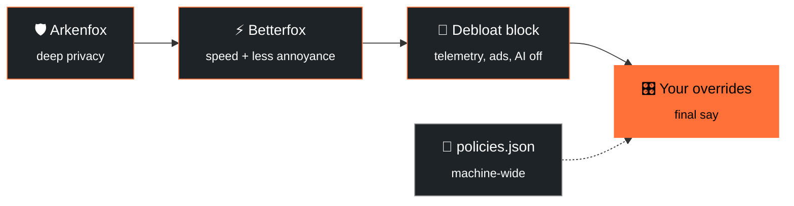

<div align="center">


<a href="https://github.com/apauruseya-stack/firefox-hardened">
  
</a>

<br/>


**A layered, reversible hardening stack for the real Mozilla Firefox.**
<br/>
`firefox-debloat` + `Arkenfox` + `Betterfox` + your own overrides, stacked in the right order.

[**Quick start**](#-quick-start) · [**The layers**](#-the-four-layers) · [**Why this stack**](#-why-this-stack) · [**Revert**](#-undo-everything) · [**Screenshots**](#-screenshots)

</div>

<br/>

> [!NOTE]
> **Status:** personal toolkit, shared as-is. Read the [warnings](#-warnings--trade-offs) before applying.

---

## ✨ The 10-second pitch

| | |
|---|---|
| 🦊 **Real Firefox** | Official Mozilla binary. No fork, no third-party build. Full site and DRM support (Netflix, banking) and instant security updates. |
| 🧹 **Debloated** | Telemetry, studies, crash reports, sponsored content, Firefox Suggest, recommendations and AI features are switched off. |
| 🛡️ **Hardened** | ETP Strict, HTTPS-only, referer trimming, containers, FPP, optional RFP, plus CanvasBlocker. |
| ⚡ **Fast** | Betterfox network, cache and GFX tuning with speculative loading re-enabled. |
| ♻️ **Reversible** | One command to roll back. Backups are created automatically. |

---

## 🧱 The four layers

Firefox reads `user.js` on every start and the **last value wins**. Enterprise policies (`policies.json`) apply machine-wide and show up in `about:policies`.



> **Order matters:** Arkenfox → Betterfox → debloat block → overrides. The more specific and personal a layer is, the later it loads, so it wins.

| Layer | Source | Scope | Reversible? |
|---|---|---|---|
| 📜 **Policies** | `config/policies.json` (firefox-debloat) | all profiles, all users | ✅ `.debloat-orig` backup |
| 🧹 **Debloat prefs** | managed block in `user.js` | per profile | ✅ block removed on `-Revert` |
| 🛡️ **Arkenfox** | full `user.js` template | per profile | ✅ restore backup |
| ⚡ **Betterfox** | curated `user.js` | per profile | ✅ restore backup |
| 🎛️ **Overrides** | appended prefs | per profile | ✅ delete the block |

The debloat script is **idempotent** and leaves everything outside its managed block alone, so re-running it never wipes your Arkenfox, Betterfox or override layers.

---

## 🚀 Quick start

### 📋 Requirements

| | Windows | Linux |
|---|---|---|
| **Interpreter** | Windows PowerShell 5.1+ (built in) or PowerShell 7+ | Bash 4+ |
| **Dependencies** | none | `jq` |
| **Privileges** | UAC prompt only for the policies step | `sudo` only for `policies.json` |
| **Firefox** | installed and opened once (so a profile exists) | same |

> 💡 Recommended: **Firefox 152+** (needed for the `AIControls` and `DisableAccounts` policies).

### 🪟 Windows

```powershell
# 1. Clone
git clone https://github.com/apauruseya-stack/firefox-hardened.git
cd firefox-hardened

# 2. Install Firefox if you don't have it
winget install --id Mozilla.Firefox --silent --accept-package-agreements --accept-source-agreements

# 3. Open Firefox once, then close it (this creates your profile)
& "C:\Program Files\Mozilla Firefox\firefox.exe"

# 4. Apply the debloat layer (UAC prompt appears for the policies step)
powershell -ExecutionPolicy Bypass -File .\windows\firefox-debloat.ps1
#    Want to keep Sync?  add:  -KeepSync

# 5. Layer Arkenfox + Betterfox on top
powershell -ExecutionPolicy Bypass -File .\scripts\merge-arkenfox-betterfox.ps1

# 6. (Optional) personal overrides, see "Customizing" below

# 7. Restart Firefox, then verify at about:policies and about:config
```

<details>
<summary><b>📦 Downloaded as a ZIP?</b> Unblock the files first</summary>

```powershell
Get-ChildItem -Recurse | Unblock-File
```

</details>

### 🐧 Linux

```bash
git clone https://github.com/apauruseya-stack/firefox-hardened.git
cd firefox-hardened
./linux/firefox-debloat.sh
# then append the Arkenfox + Betterfox user.js content and your overrides to your profile's user.js
```

> 🤝 The Linux merge step isn't scripted yet. **PRs welcome!**

---

## 🎯 What it does (and doesn't)

<table>
<tr>
<td width="50%" valign="top">

### ✅ Does

- 🚫 Disables telemetry, Shield/Normandy studies, crash reports, sponsored content, Firefox Suggest, recommendations, AI features and Mozilla promotions
- 🔍 Sets **Brave Search** as the default engine (via the `SearchEngines` policy)
- 🧩 Auto-installs a curated extension set (see below)
- 🔑 Turns off built-in password manager, address and card autofill and Web Payments (Proton Pass replaces them)
- 🧼 Cleans the new tab page and UI annoyances (blank new tab, no Top Sites or sponsored content)
- 🛡️ Hardens privacy: ETP Strict, HTTPS-only, disk cache off, referer trimming, containers, FPP, optional RFP, sanitizing
- ⚡ Tunes network, caches, GFX and speculative loading
- 🔄 Optionally disables Firefox Account / Sync (`-KeepSync` / `--keep-sync` keeps it)

</td>
<td width="50%" valign="top">

### ❌ Does not

- 🔁 Change your search engine after the fact if you override it in Firefox settings (the policy sets the *default*)
- ➕ Install extensions outside `ExtensionSettings` (add others manually)
- 🔓 Disable security features: **Safe Browsing, updates and Remote Settings stay on**
- 🎭 Go beyond FPP / RFP / CanvasBlocker for fingerprinting (no custom spoofs beyond what Arkenfox provides)
- 🍪 Touch cookies, history or passwords beyond the sanitize-on-shutdown defaults (which you can disable in overrides)
- 🏠 Change your homepage (startup page is blank via Arkenfox, new tab is Firefox default unless you add an extension)

</td>
</tr>
</table>

### 🧩 Auto-installed extensions

| Extension | Purpose |
|---|---|
| **uBlock Origin** | content blocking |
| **Proton Pass** | password manager (replaces Firefox's built-in one) |
| **Privacy Badger** | tracker learning and blocking |
| **CanvasBlocker** | per-site canvas / WebGL / audio randomization |
| **TWP (Translate Web Pages)** | translation |
| **PopUpOFF** | popup and overlay control |
| **Popup Blocker (strict)** | popup blocking |

---

## 🥊 Why this stack

How it compares with **stock Firefox** and **LibreWolf**:

| | Stock Firefox | LibreWolf | **This stack** |
|---|:---:|:---:|:---:|
| Telemetry / ads / AI removed | ❌ | ✅ | ✅ |
| Security features kept | ✅ | ⚠️ Mostly | ✅ |
| Official Mozilla binary and updates | ✅ | ❌ | ✅ |
| Site / DRM compatibility | 🏆 Best | ⚠️ Reduced | 🏆 Best |
| Fingerprinting protection | ❌ None | RFP (standardize) | FPP + optional RFP + CanvasBlocker (randomize) |
| Reversible | n/a | Uninstall | ✅ `-Revert` |
| Breakage risk | None | Higher | Low |
| Setup effort | None | Install a browser | Run scripts |

<details>
<summary><b>🕵️ Fingerprinting</b></summary>

- **Stock Firefox:** no fingerprinting protection. Your real UA, screen size, timezone, canvas, WebGL, fonts, hardware concurrency and DNT header are exposed. Cover Your Tracks reports a unique fingerprint.
- **LibreWolf:** RFP is on by default. It's strong, but it forces GMT timezone, light theme and window letterboxing, and breaks some sites. The RFP population is small, so you can still look unique.
- **This stack:** RFP is available (enable it in overrides) plus CanvasBlocker in "fake" mode, which randomizes canvas / WebGL / audio / DOMRect / screen / navigator **per site** (Brave-like). The DNT header is disabled to remove an identifying bit, and FPP (via ETP Strict) is on by default. Per-site randomization makes cross-site tracking much harder while keeping more sites working.

</details>

<details>
<summary><b>🔒 Safety and security</b></summary>

- **Stock Firefox:** Safe Browsing, updates and Remote Settings are on, but telemetry, studies and crash reports send data out.
- **LibreWolf:** disables many features, and some security-related remote services may be reduced. Updates come from LibreWolf's own channel, which can lag.
- **This stack:** keeps every security feature on (Safe Browsing, updates, Remote Settings, captive portal) and removes data collection and ad / tracking content. It uses the official Mozilla binary, so Mozilla's security updates arrive immediately. Policies are official enterprise mechanisms: reversible, auditable, visible in `about:policies`.

</details>

<details>
<summary><b>⚡ Speed and performance</b></summary>

- **Stock Firefox:** default network and cache settings, speculative loading on.
- **LibreWolf:** RFP and stricter settings can slow some loads, and letterboxing adds overhead.
- **This stack:** Betterfox Fastfox tuning (more connections, larger buffers, DNS cache, media / image cache, skia font cache) plus re-enabled speculative loading (DNS prefetch, link prefetch, speculative connections). Disk cache is off for privacy; enable it in overrides for faster repeat loads.

</details>

<details>
<summary><b>🧰 Convenience and compatibility</b></summary>

- **Stock Firefox:** nothing to set up, but noisy (telemetry, ads, AI, recommendations).
- **LibreWolf:** a separate browser with its own profile and update channel. It breaks some sites (banking, video, captchas) and is harder to undo.
- **This stack:** runs on stock Firefox with full site and DRM compatibility, official updates, and a one-command revert. It keeps your profile and extensions, auto-installs the curated extension set, and can keep Sync with `-KeepSync`.

</details>

---

## 🎛️ Customizing

| I want to... | Do this |
|---|---|
| Change policies or debloat prefs | Edit `config/policies.json` / `config/user.js`, then re-run the script |
| Keep Firefox Sync | `-KeepSync` / `--keep-sync` |
| Lock policies (greyed out in the UI) | `-Lock` / `--lock` |
| Block local translation too | `-BlockTranslations` / `--block-translations` |
| Tweak Arkenfox | Edit prefs in its `user.js` (look for `[SETUP-*]` tags). RFP is off by default; enable it in overrides |
| Add personal overrides | Copy `overrides/user-overrides.example.js`, edit it, and **append it to the end of your profile's `user.js`** (it is not auto-loaded) |

---

## ⚠️ Warnings & trade-offs

> [!WARNING]
> This stack trades a little privacy for convenience in a few places. Know them before you apply it.

1. **Stay-logged-in vs. privacy.** Arkenfox clears cookies and site data on close. The provided overrides disable that so you stay signed in. Remove those override lines for the stricter default.
2. **RFP is optional.** Enabling it forces GMT timezone, prefers the light theme and rounds window size. It can break canvas-heavy or timezone-sensitive sites.
3. **Speculative loading is re-enabled** for speed, which is a minor privacy trade-off.
4. **Disk cache stays off** for privacy. Enable it in overrides for faster repeat loads.
5. **Site breakage.** ETP Strict + RFP + disabled prefetch can break a few sites (banking, captchas, some web apps). Use the shield icon in the address bar to add per-site exceptions.
6. **Extensions are force-installed** via policy. To change the list, edit `ExtensionSettings` in `config/policies.json` and re-run. To disable auto-install entirely, remove that block.
7. **CanvasBlocker + RFP** can run together. CanvasBlocker's FAQ confirms RFP can stay on, and its default mode is "fake" (per-site randomization).
8. **Brave Search preferences** ("Anonymous local results", "Discussions", "Anonymous usage metrics") are Brave settings, not Firefox settings. After your first search, open Brave Search's gear icon → Preferences and turn them off. The choice persists in a cookie for this profile.
9. **Profile data is never committed.** `.gitignore` excludes `prefs.js`, backups and `user-overrides.js`. Don't commit real profile files.

---

## ↩️ Undo everything

```powershell
# Close Firefox first (it rewrites prefs.js on exit).
powershell -ExecutionPolicy Bypass -File .\windows\firefox-debloat.ps1 -Revert
```

Then restore your profile's `user.js` from the backup the merge script created (`user.js.bak-<timestamp>` in the profile folder), or delete `user.js` entirely to return to Firefox defaults. **Policies revert automatically** via the `.debloat-orig` backup.

---

## 🔧 Maintenance

- 🔄 Arkenfox and Betterfox are static `user.js` files. **Re-run the merge script** to pull the latest versions when Firefox updates.
- 🧽 Arkenfox recommends running `prefsCleaner` after major Firefox updates to reset deprecated prefs.
- 🔁 The debloat script is idempotent. Re-running it regenerates policies from the original plus `config/`.

---

## 📸 Screenshots

<div align="center">

### Enterprise policies (`about:policies`)
<a href="screenshots/about-policies.png"></a>

<br/><br/>

### Installed extensions (`about:addons`)
<a href="screenshots/about-addons.png"></a>

</div>

---

## 🙏 Credits & licenses

| Project | Role | License |
|---|---|---|
| [firefox-debloat](https://github.com/henriquesebastiao/firefox-debloat) by henriquesebastiao | Vendored under `windows/`, `linux/`, `config/`, `tests/` | AGPL-3.0 (original license kept) |
| [Arkenfox user.js](https://github.com/arkenfox/user.js) | Deep privacy layer | MIT |
| [Betterfox](https://github.com/yokoffing/Betterfox) | Performance and annoyance layer | see its LICENSE |
| This repo's original additions (merge script, overrides example, README) | Glue | AGPL-3.0, to stay compatible with the vendored code |

If you redistribute, keep the licenses and attribution.

<br/>

<div align="center">

**Found it useful? Drop a ⭐ and share it.**


</div>
